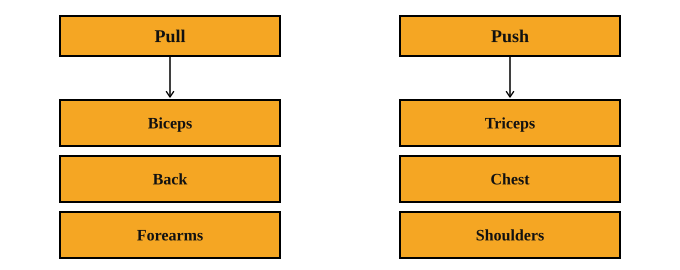

## Playlist

I always put it on shuffle:  

## Skin care
I use 0.05g of tretinoin, moisturizer whenever my skin peels or feels dry, and sunscreen whenever I go out in the sun. I also shower once or twice a day with cold water and let my hair air-dry.

## Macro sources
I usually get my protein from protein powder, boiled eggs, chicken breasts, beef, and cans of tuna and sardines. My carbs mainly come from rice (preferably brown), noodles, bananas, and apples.

## Split
  
When you pull, you usually use these muscles, and when you push, you usually use those. Having this in mind, here's my split:
| Focus | Exercises |
|:------:|------------|
| Pull | Pull-down machine (varied attachments), Vertical row, [Seated cable row](https://www.youtube.com/watch?v=UCXxvVItLoM), [Face pull](https://www.youtube.com/watch?v=0Po47vvj9g4), [Cable bicep curl](https://www.youtube.com/watch?v=2MUEL4nL6hA), [Bicep curl (dumbbell)](https://archive.org/details/document_5841665777559674614), [Cable wrist curl](https://archive.org/details/video5895212363199552969) |
| Push | Flat/incline bench press, Chest press, Incline press, Pec deck, [Tricep pushdown (rope)](https://www.youtube.com/watch?v=vB5OHsJ3EME), Seated dip, Shoulder press, Lateral raise |
| Legs | Squat (barbell, hack, or goblet), Leg press, Leg extension, Prone leg curl, Leg curl, Hip abduction/adduction, Calf raise |

Note that I don't necessarily do them all; I consider it a menu. For example, I might do prone leg curl and skip leg curl or vice versa. Similarly, I might do vertical row and skip seated cable row, and sometimes I might skip a number of exercises altogether.
